<div align="center">

# Innovation HUB | Eurofarma

**Plataforma de inovação colaborativa que transforma cada colaborador, do escritório ao chão de fábrica, em um agente de melhoria contínua.**

**Projeto vencedor do desafio da Eurofarma na FIAP Global Solution 2026.**


**[Ver demo ao vivo](https://luanrodrigues15.github.io/innovationhub-eurofarma-challenge/)** · entre com um clique em "Acessar como", sem cadastro, e ative o tour guiado no canto da tela

</div>

---

## Destaques

- Quatro perfis completos (funcionário, gestor, administrador e totem) navegáveis sem senha
- Innovation IA (Eura) que conduz a ideia com uma pergunta por vez, calcula o AI Score e filtra conteúdo inadequado
- Score híbrido: o gestor define o peso da nota da IA e da comunidade na triagem
- Versão de portfolio que roda inteira no navegador, sem banco de dados nem servidor, com tour guiado de 14 passos

## Screenshots

| | |
|---|---|
| Tela inicial | Acessar como (um clique por perfil) |
| 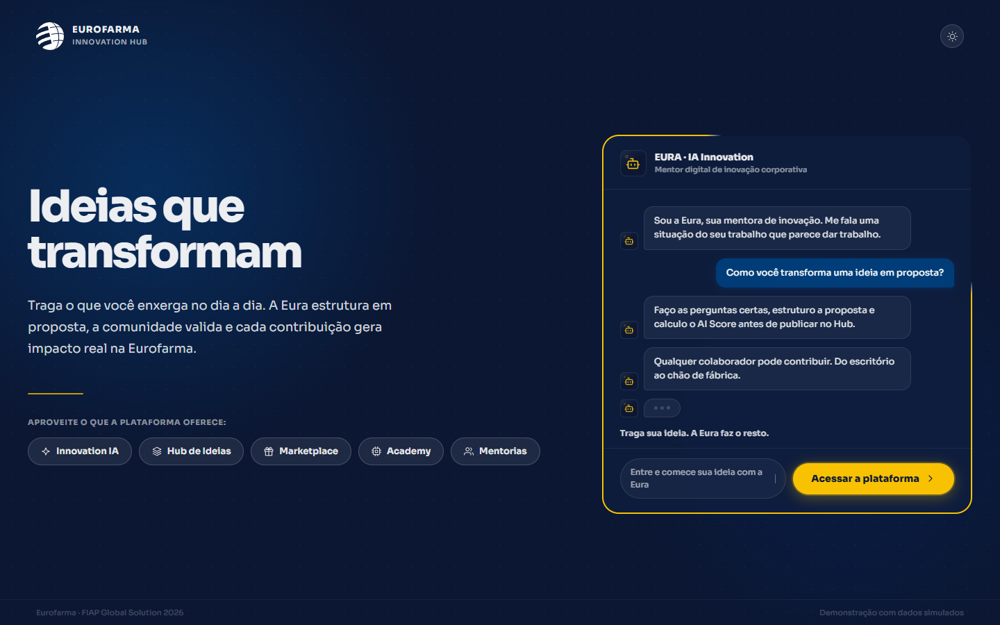 | 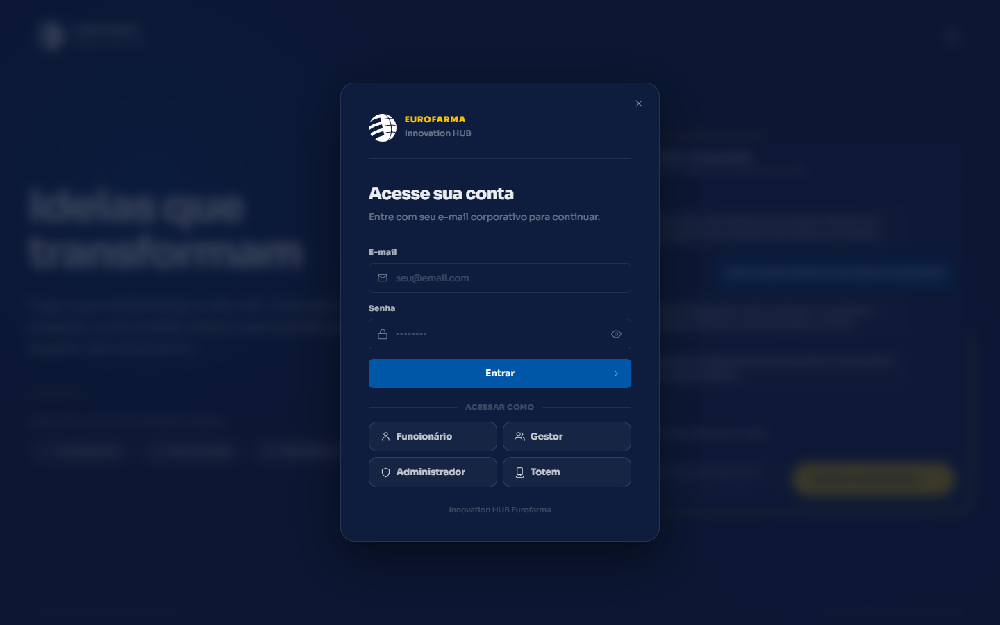 |
| Painel do funcionário | Innovation IA: proposta estruturada com AI Score |
| 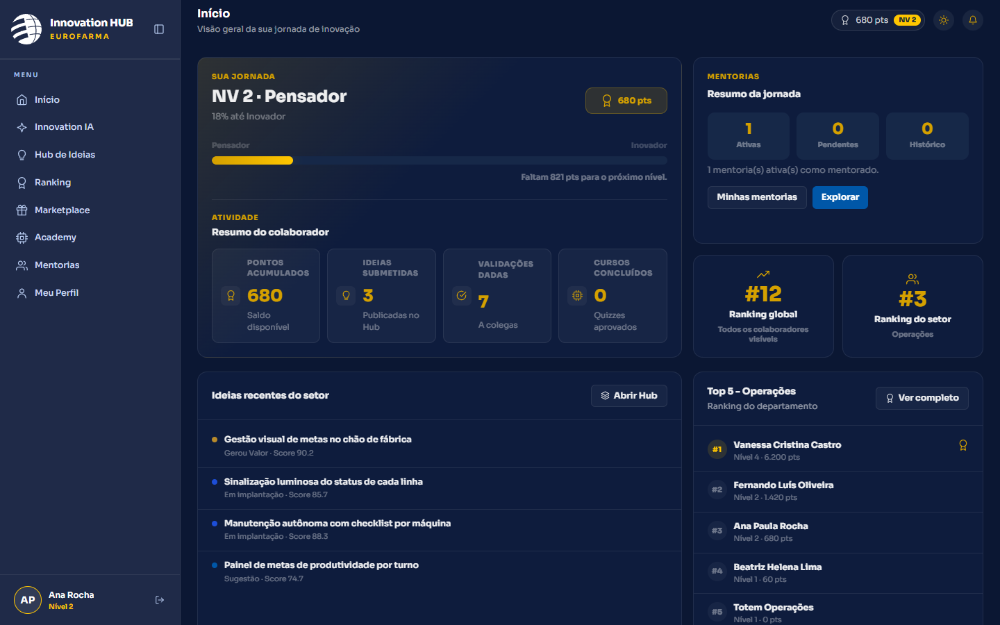 | 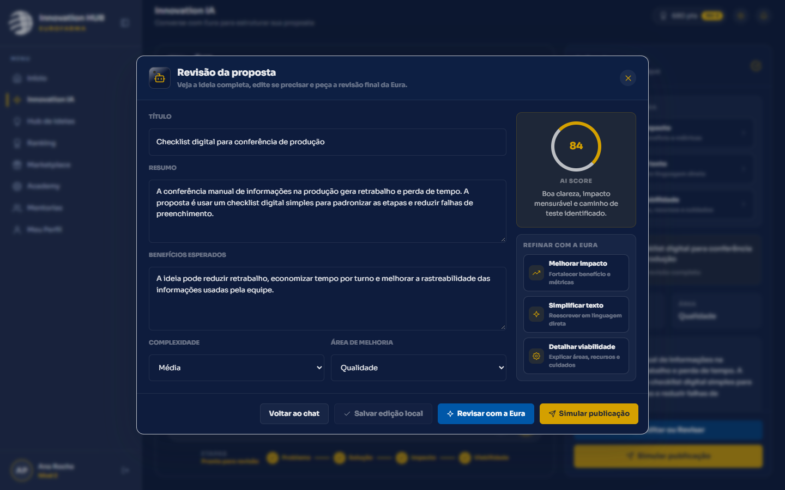 |
| Hub de Ideias | Marketplace de recompensas |
| 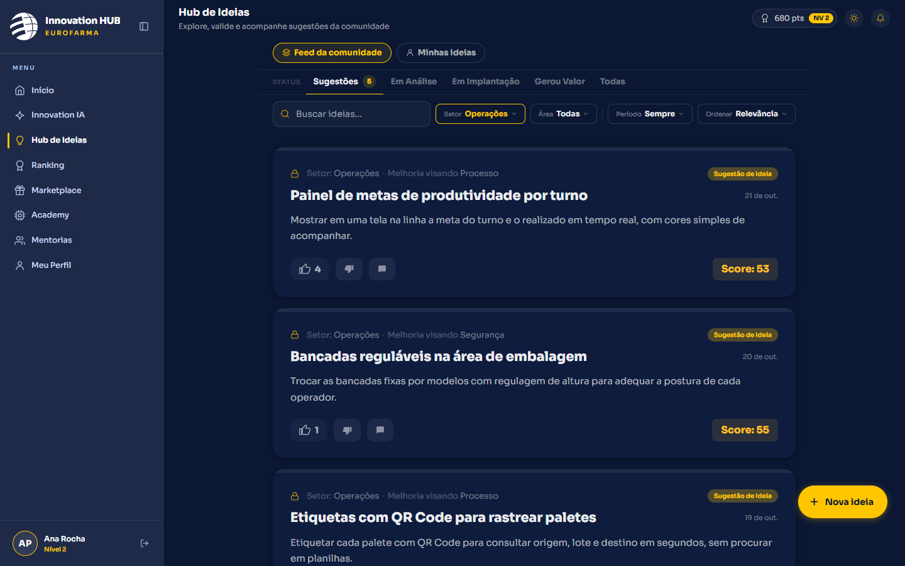 | 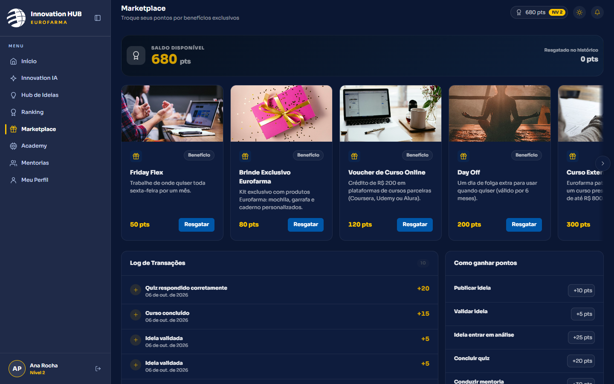 |
| Ranking por setor ou global | Triagem do gestor (peso do score híbrido) |
| 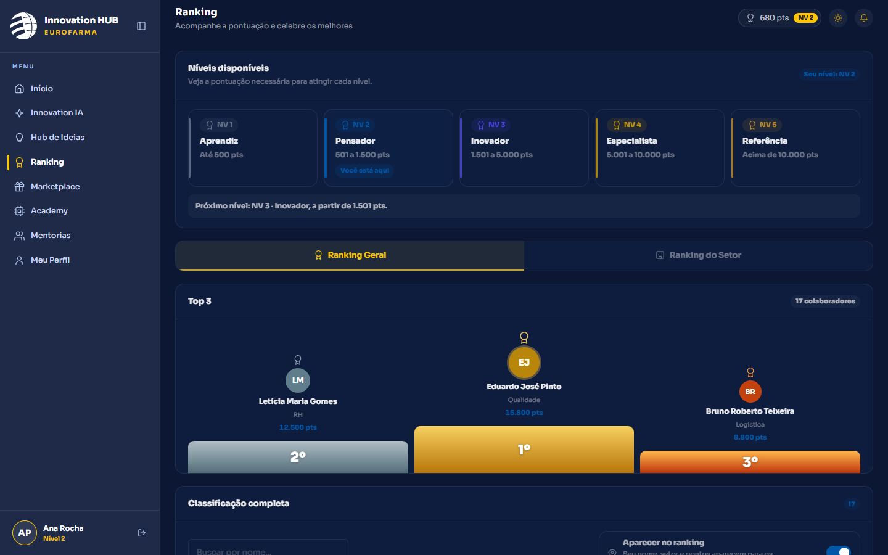 | 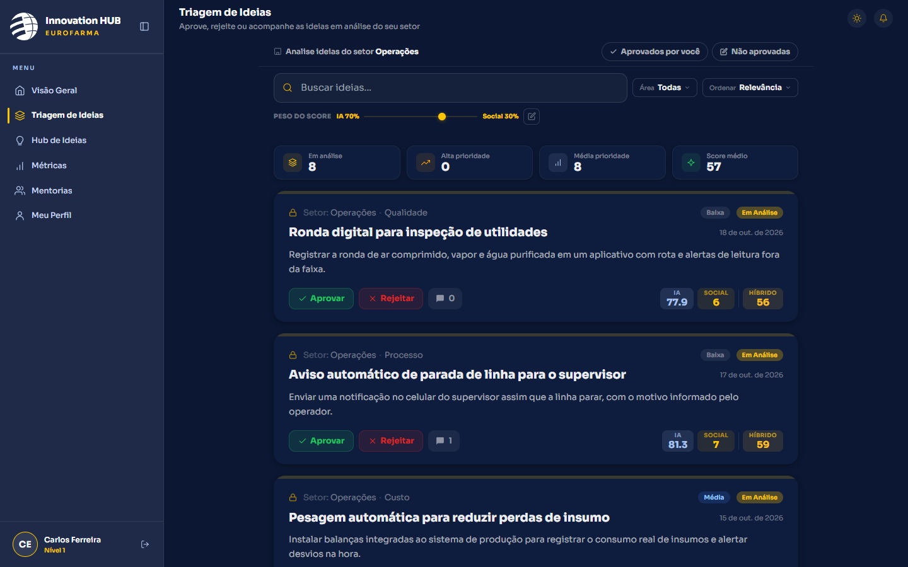 |
| Métricas do setor | Painel do administrador |
| 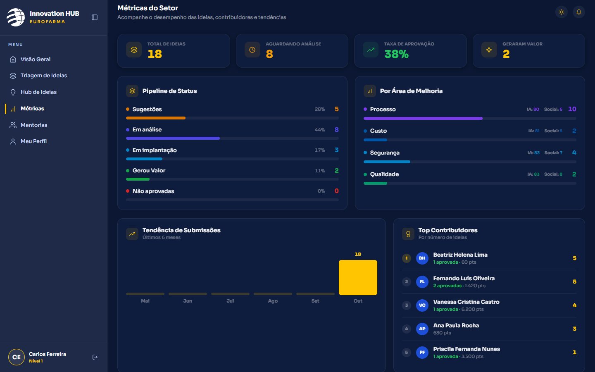 | 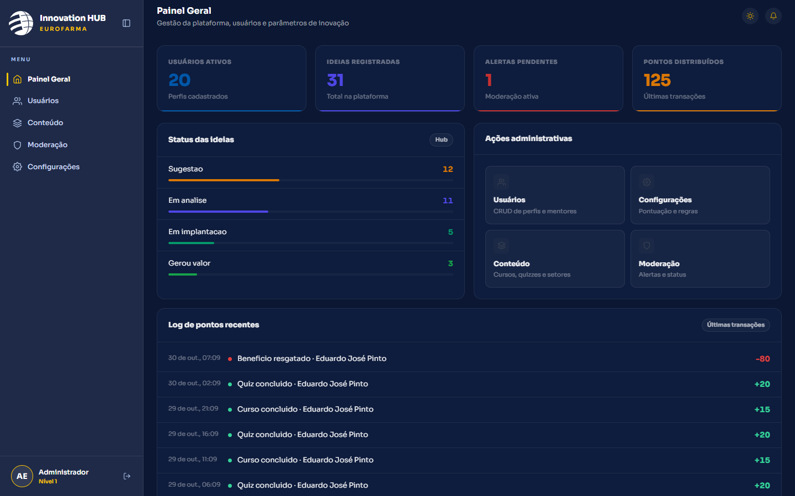 |
| Regras da plataforma | Modo Totem (tablet no chão de fábrica) |
| 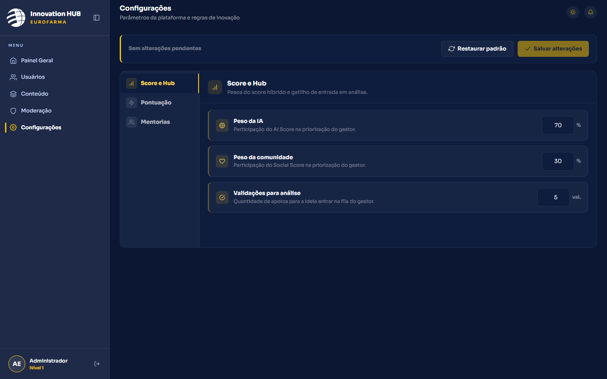 | 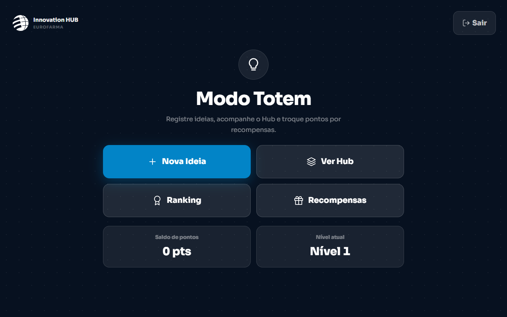 |
| Totem: ideia por voz | Tour guiado, com o perfil sempre explícito |
| 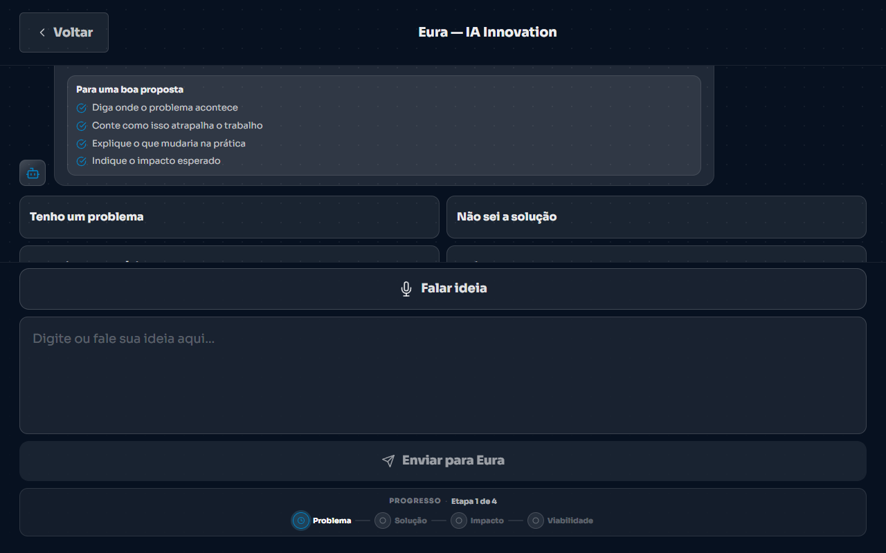 | 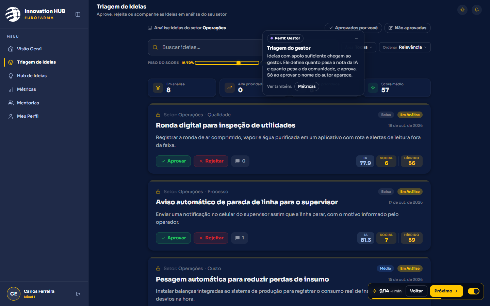 |

## Sobre o projeto

Boas ideias ficam presas em quem as tem, principalmente no chão de fábrica. O desafio proposto pela Eurofarma era transformar todos os colaboradores em participantes de inovação, mesmo quem não tem e-mail corporativo nem computador. Quatro perguntas guiaram o projeto:

1. Como ajudar quem tem a ideia mas não sabe estruturar uma proposta?
2. Como garantir que ela chegue ao gestor com contexto suficiente para ser avaliada?
3. Como manter o engajamento quando a pessoa não sabe se a ideia foi lida?
4. Como incluir quem está no chão de fábrica?

As respostas viraram os módulos da plataforma:

| Módulo | O que faz |
|---|---|
| **Innovation IA (Eura)** | Conduz a ideia com uma pergunta por vez, calcula o AI Score e filtra conteúdo inadequado |
| **Hub de Ideias** | Mural com filtros, comentários e validação anônima entre colegas |
| **Triagem do gestor** | Score híbrido com peso ajustável entre a nota da IA e a da comunidade; o autor só aparece na aprovação |
| **Gamificação** | Pontos, níveis, ranking por setor ou global e Marketplace de recompensas |
| **Academy e Mentorias** | Cursos com quiz e rede de mentoria interna |
| **Modo Totem** | Login por matrícula, botões grandes e ideia por voz para o chão de fábrica |
| **Administração** | Usuários, conteúdo, moderação e regras de pontuação |

> **Nota sobre os dados:** esta é uma **versão de portfolio**. Todas as pessoas, ideias e números são fictícios e as ações ficam só na sua aba: fechar a aba reinicia a demonstração. A versão original usava Supabase (PostgreSQL e Auth) e Google Gemini. Projeto acadêmico desenvolvido para a Eurofarma; nome e identidade visual pertencem à Eurofarma e são usados aqui apenas para demonstração.

## Como explorar

Clique em **Acessar a plataforma** e escolha um perfil em **Acessar como**.

| Perfil | O que mostra |
|---|---|
| Funcionário | Painel, Innovation IA, Hub de Ideias, Ranking, Marketplace, Academy e Mentorias |
| Gestor | Triagem de ideias, métricas do setor e aprovação de mentorias |
| Administrador | Usuários, conteúdo da Academy, moderação e regras da plataforma |
| Totem | Versão para tablets no chão de fábrica, com ideia por voz |

### Tour guiado

O botão **Fazer o tour** (canto inferior direito) conta a jornada de uma ideia em 14 passos, em cerca de 3 minutos. Ele é opcional e pode ser ligado e desligado a qualquer momento.

- **Controles fixos:** Voltar e Próximo ficam sempre no mesmo canto; o balão de texto se move até a parte do site que está sendo mostrada.
- **Perfil explícito:** o balão mostra em qual perfil o tour está, e um aviso aparece a cada troca de usuário.
- **Tour inteligente:** se você começar a explorar por conta, o botão vibra e oferece o tour da aba ou do perfil em que você está.

## Arquitetura

```
┌───────────────────────────────┐
│  Telas originais (Next.js)    │   app/ e components/
└──────────────┬────────────────┘
               │ chamam
┌──────────────▼────────────────┐
│  services/ (acesso a dados)   │   mesmos serviços do projeto original
└──────────────┬────────────────┘
               │ createClient()
┌──────────────▼────────────────┐
│  Cliente simulado             │   lib/mock: mesma API do supabase-js
│  consultas · sessão · Eura    │
└──────────────┬────────────────┘
               │
        Banco em memória (sessionStorage), semeado com dados fictícios
```

## Decisões de arquitetura

**Trocar o cliente, não as telas.** O app original falava com o banco só pela API do `supabase-js`. Em vez de reescrever cerca de 180 chamadas, o cliente foi substituído por um que tem a mesma API e roda em memória: filtros, ordenação, selects relacionais, contagem, upsert e exclusão em cascata. As telas, os serviços e a lógica de pontos e aprovação seguem exatamente como no projeto original.

**Exportação estática.** O GitHub Pages só serve arquivos. Middleware, rotas de API e layouts de servidor deram lugar a uma proteção de rota por perfil no navegador, e as rotas dinâmicas são pré-geradas com os ids do seed mais um pool de ids para ideias e cursos criados durante a demonstração.

**Eura simulada, demos reaproveitadas.** A conversa livre com a Eura responde por regras simples, sem chave de API. As demos roteirizadas que o pitch já usava são disparadas pelo tour dentro da própria janela, então a história roda sobre a interface real.

**Tour desacoplado das páginas.** O roteiro é só dados (`components/tour/steps.ts`); o tour observa a rota e o perfil atuais para posicionar o balão e oferecer o tour da parte em que a pessoa está.

## Stack

| Camada | Tecnologias |
|---|---|
| Frontend | Next.js 14 (App Router, exportação estática), React 18, TypeScript, Tailwind CSS, GSAP |
| Dados | Banco em memória com API compatível com o `supabase-js` (`lib/mock`) |
| Deploy | GitHub Actions e GitHub Pages |

## Rodando localmente

```bash
npm install
npm run dev
```

Abra http://localhost:3000. Para gerar o site estático:

```bash
npm run build
```

O resultado fica em `out/`. Para simular o GitHub Pages, defina `NEXT_PUBLIC_BASE_PATH=/innovationhub-eurofarma-challenge` antes do build.

---

<details>
<summary><strong>Detalhes: o que é simulado e estrutura do projeto</strong></summary>

### O que é simulado

| Na versão original | Nesta versão |
|---|---|
| Supabase (PostgreSQL e Auth) | Banco em memória com a mesma API do `supabase-js` (`lib/mock`) |
| Google Gemini | Eura simulada por regras (`lib/mock/eura.ts`) e demos roteirizadas |
| Login com e-mail e senha | Perfis de demonstração com um clique |
| Middleware e layouts de servidor | Proteção de rota por perfil no navegador (`RoleGuard`) |
| Voz do Totem | Microfone real no botão; o tour simula a fala para funcionar em qualquer navegador |

### Estrutura

```
app/            Rotas por perfil: (auth), (employee), (manager), (admin) e totem
components/     Componentes compartilhados e o tour (components/tour)
lib/mock/       Banco em memória, consultas, sessão, fixtures e Eura simulada
services/       Acesso a dados usado pelas telas
docs/           Screenshots e changelog
```

### Deploy

O workflow `.github/workflows/deploy.yml` compila o site e publica no GitHub Pages a cada push na `main`.

</details>

## Créditos

Projeto acadêmico desenvolvido para o desafio da Eurofarma na FIAP Global Solution. Nome e identidade visual pertencem à Eurofarma e são usados aqui apenas para demonstração.
